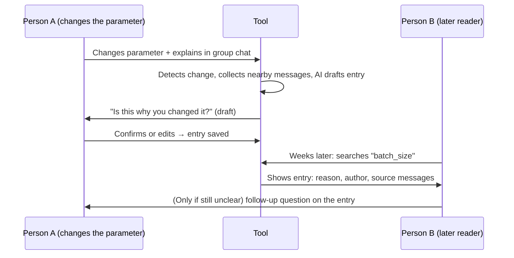

# Group 03 — Checkpoint 1

> Draft. Items marked **TODO** still need team input or interview results.

Repository: https://github.com/Yifu-17/nycu-ai-in-the-loop-115-1-G3

Team: 陳繹夫, 吳傢澂, 吳承霖, 楊敦傑

---

## 1. Team Charter

### Decisions when we disagree
1. Whoever disagrees posts their position and reasoning in the team chat. Everyone replies within 24 hours.
2. If we have not agreed after 24 hours, the person leading that piece of work (the "Led by" person in the PR template) decides.
3. If the disagreement crosses areas or the lead is one of the people disagreeing, the current code steward decides.
4. If the steward is one of the people disagreeing, the next steward in the rotation decides instead.
5. If everyone is involved, we take a majority vote of all four. On a 2–2 tie, we keep what is currently on `main` and bring the question to the TA drop-in session or office hours.
6. The decision and the rejected alternative go into DECISIONS.md so we don't argue about it again.

### Definition of done
A piece of work is done when all of these can be checked:
- It is merged into `main` through a PR (no direct pushes; branch protection enforces this).
- The current code steward approved it with at least one substantive review comment, and merged it. Only the steward approves and merges to `main`. When the steward authors the PR, the next steward in the rotation reviews it.
- The PR description follows the template, including the Decision section if a significant choice was made.
- If the choice changes our approach, a DECISIONS.md entry exists.
- If AI produced part of it, the PR says so in one line, and prompts that produced saved log entries are recorded in the prompt log (see DECISIONS.md, AI Usage Guidelines).
- For code: someone other than the author ran it once and it did what the PR says.

### Code steward rotation
The steward changes every week, in this order: 陳繹夫 → 吳傢澂 → 吳承霖 → 楊敦傑, starting Week 7 (**TODO: team to confirm order**).

| Week | 7 | 8 | 9 | 10 | 11 | 12 | 13 | 14 |
|---|---|---|---|---|---|---|---|---|
| Steward | 陳繹夫 | 吳傢澂 | 吳承霖 | 楊敦傑 | 陳繹夫 | 吳傢澂 | 吳承霖 | 楊敦傑 |

Everyone is steward once before CP2 (Week 12) and twice before CP3 (Week 15), as the course requires. Each handover gets a DECISIONS.md entry.

### Communication outside class
- **Channel:** LINE group for day-to-day messages (**TODO: confirm channel**); GitHub PRs and issues for anything about the code.
- **Frequency:** one short sync every week (**TODO: day/time**), plus async updates whenever someone opens or merges a PR.
- **Response time:** reply within 24 hours on weekdays, 48 hours on weekends. Before a deadline (the 3 days before a checkpoint), reply within 12 hours. If you can't make that, say so in the group.

---

## 2. Problem Statement with Evidence

### The problem
When someone on a team that shares a server (for example a lab GPU server or a shared course server) changes a parameter, they usually explain why in the group chat. The explanation stays in chat history, separate from the change. Weeks later, when someone sees an unexpected value or a behavior change, they have to scroll back through chat or ask the original author, who may not remember.

**Who experiences it:** (1) the teammate who later needs to understand or undo the change, and (2) the original author, who gets asked again.

**TODO:** refine this wording after interviews. Keep only what the interviewees confirm.

### Evidence from real users
**TODO: at least 2 people outside our team** (1 of 2 done). For each, record:

| | Interviewee 1 | Interviewee 2 |
|---|---|---|
| Who (role, what they share) | Master's student, National Taiwan Ocean University, in a course on protein recognition models. Team of 4 sharing one GitHub repo, one training config file, and a cloud folder of experiment results. Each person owns a part (data preprocessing/embeddings, model architecture, hyperparameters/training, evaluation), but everything runs as one model. | |
| How often they change shared settings | Almost every week; 2–3 times a day in the 1–2 weeks before a report is due. Most changed: learning rate, batch size, dropout, layer dimensions, data split. Often several people change things on different branches at once. | |
| Last concrete incident (what, when, cost) | About 3 weeks ago an old branch scored nearly 3 points higher validation accuracy than `main`. They suspected a layer before the classification head had changed, but commits only said "update model" / "fix". It took about two evenings of checking out and diffing branches and messaging each person "did you change this?". They still could not pin down the cause (data split and learning rate also differed), had to rerun experiments (lost GPU time), with under a week to the deadline. | |
| How they currently record reasons | Scattered: casual commit messages, occasional LINE messages ("I changed dropout to 0.3"), a Google Doc / Notion page nobody maintains. Results sometimes live only in one person's Jupyter notebook or a wandb screenshot, so it's hard to match them to a version. | |
| What they said doesn't work | Commit messages are too brief to understand a few days later. LINE messages get buried. Nobody updates the shared doc when rushing. Notes are separate from branches and results, so they can't be mapped to "which layer in which version". "Write a reason for every change" is a rule nobody enforces, and it's awkward to nag teammates. | |
| Concerns about an AI-drafted log | • **Accuracy:** from a diff alone the AI knows *what* changed, not *why*, and may invent a plausible reason.<br>• **Accountability:** people may stop writing real reasons; whose name is on the entry must be clear.<br>• **Human confirmation:** draft only, valid after the author reviews it; mark AI-inferred vs. author-confirmed parts.<br>• **Privacy:** code/data may involve the professor's unpublished research; unsure if it can go to an external AI.<br>• **Burden:** if fixing a long AI paragraph is more work than writing one line, nobody will use it.<br>• **Detail:** should capture which layer, old → new value, and the linked branch and experiment result. | |

### Why existing tools do not solve it
Candidates to check during interviews (**TODO: keep only the ones users actually mention, and tie each to a quote**):
- **Git commit messages:** only help when the config is in git. Many shared-server changes are made by editing files or running commands directly, so no commit exists.
- **Chat search / pinned messages:** the reason exists, but you can only find it if you know the keywords and roughly when the change happened. Nothing links the message to the parameter.
- **Wiki / Notion change log:** needs someone to write the entry by hand after the fact. That step gets skipped.

---

## 3. Initial Interaction Design Sketch

### What the tool does
It notices when a parameter on the shared server changes, finds the related chat messages, and drafts a change-log entry with the reason. The author confirms or edits the draft before it is saved, so later readers can look up a parameter and see why it changed.

### Inputs and outputs
**Inputs**
1. A change event: parameter name, old value, new value, who changed it, and when (for example from a diff of a watched config file).
2. The team chat messages from a time window around the change (for example ±2 hours).

**Output:** one change-log entry, saved to a searchable log:

```
## batch_size: 32 → 64
When:    2026-10-15 14:02
Who:     <author>
Why:     <AI-drafted, author-confirmed summary of the reason>
Sources: <links/quotes of the chat messages used>
Status:  confirmed by author
```

**Open questions:** we haven't decided how to detect changes (watch a config directory or wrap the edit command), or which chat platform to read from. LINE has no easy export API; Discord/Slack do. We will decide after the interviews show what people actually use.

### How two people interact with it



- **Person A** changes the parameter and explains it in chat as usual. Their only extra step is to confirm or fix the draft.
- **Person B** searches the log by parameter or date instead of scrolling chat or asking A.
- **Handoff:** the confirmed entry is what passes from A to B. If B still has a question, they reply on that entry, so the follow-up also stays attached to the change.

---

## 4. Draft Evaluation Plan

### Success definition
We will know our tool works if:
1. **Retrieval:** a person who did not make a change can find the correct reason for it faster with the tool than by searching chat history. Measured as time to a correct answer and the share of correct answers.
2. **Low review cost:** authors accept most AI drafts with minor edits (changing at most one sentence) instead of rewriting them. If they rewrite most drafts, the tool just moves the writing work instead of removing it.

### Target users and access
- **Who:** people outside our team who share a server and coordinate changes in a group chat, for example lab members sharing a GPU server or students in other courses with a shared deployment.
- **How we reach them:** we will start with the CP1 interviewees and ask them to bring one labmate, so we can test in pairs (A and B). **TODO: list names/labs once the interviews are done.**
- **Size:** 3 pairs (6 people): 3 authors (Person A) and 3 readers (Person B).

### Method and timing
**Structured observation.**
- Weeks 11–12: pilot with our own team to fix obvious problems (this does not count as evidence).
- Weeks 13–14 (after CP2, in the Phase 3 evaluation window): sessions with outside pairs, about 30 minutes each:
  1. Person A makes 4 realistic parameter changes and explains each one in chat, then reviews the tool's 4 drafts. We record how many drafts they accept, edit, or rewrite.
  2. Person B answers "why was X changed?" for those same 4 changes: 2 by searching chat only and 2 with the tool. Which changes use which method is swapped between pairs. The chat contains other unrelated messages from that group, so searching it is realistic. We record time and correctness.
  3. A 5-minute debrief interview with both.

  Limitation: B asks right after the changes, not weeks later, so this tests finding the reason, not remembering it.

### Minimum evidence threshold
A skeptic should be convinced if:
- For at least 2 of the 3 Person-B participants, both answers found with the tool are correct and their average time with the tool is lower than their average time with chat search, and
- At least 9 of the 12 AI drafts (3 authors × 4 changes) are accepted unchanged or with minor edits.

If we fall short, we report that honestly. With only 6 people this is a small sample, so we treat it as a signal, not proof.

### Human-AI boundary
- **AI decides:** which chat messages are related to a change, and the first draft of the "why" summary.
- **Human decides:** whether the summary is correct (nothing is saved without the author's confirmation), whether to save an entry at all, and anything about whether a change was safe or should be reverted. The AI never makes or approves changes to the server.
- If the author and a reader disagree about whether an entry is accurate, the author's confirmation is what counts (consistent with our AI Usage Guidelines in DECISIONS.md).

### What we're unsure about
- Whether people outside our team actually lose time on this often enough to care. The interviews will tell us.
- Whether chat messages near a change usually contain the reason at all, or whether reasons are often never written down.
- Which chat platform we can realistically read from.

---

## 5. Repository

- Link: https://github.com/Yifu-17/nycu-ai-in-the-loop-115-1-G3
- Branch protection on `main`: enabled
- PR template: `.github/PULL_REQUEST_TEMPLATE.md`
- DECISIONS.md: started (AI usage guidelines, current steward and rotation, evaluation plan revised for CP1)
- Current code steward: 陳繹夫 (@Yifu-17), recorded in DECISIONS.md
