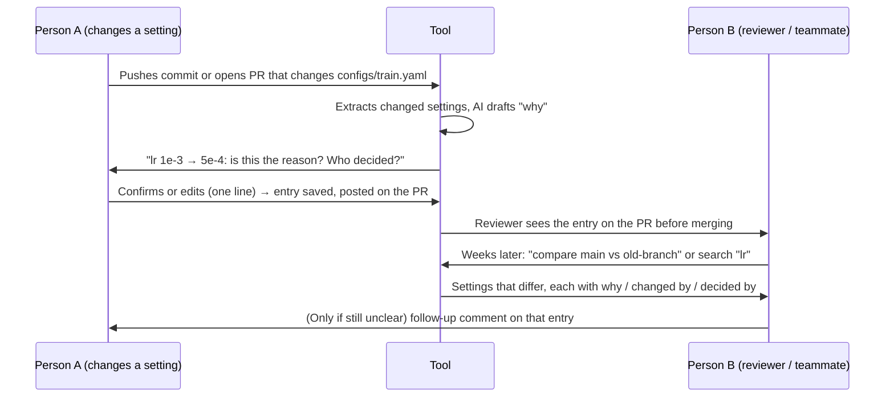

# Group 03 — Checkpoint 1

Repository: https://github.com/Yifu-17/nycu-ai-in-the-loop-115-1-G3

Team: 陳繹夫, 吳傢澂, 吳承霖, 楊敦傑

---

## 1. Team Charter

### Decisions when we disagree
1. Whoever disagrees posts their position and reasoning in the team chat. Everyone replies within 24 hours.
2. If we have not agreed after 24 hours, the person leading that piece of work (the "Led by" person in the PR template) decides.
3. If the disagreement crosses areas or the lead is one of the people disagreeing, the current code steward decides.
4. If the steward is one of the people disagreeing, the next steward in the rotation decides instead.
5. If everyone is involved, we take a majority vote of all four. On a 2–2 tie, we keep what is currently on `main` and bring the question to the TA drop-in session or office hours.
6. The decision and the rejected alternative go into DECISIONS.md so we don't argue about it again.

### Definition of done
A piece of work is done when all of these can be checked:
- It is merged into `main` through a PR (no direct pushes; branch protection enforces this).
- The current code steward approved it with at least one substantive review comment, and merged it. Only the steward approves and merges to `main`. When the steward authors the PR, the next steward in the rotation reviews it.
- The PR description follows the template, including the Decision section if a significant choice was made.
- If the choice changes our approach, a DECISIONS.md entry exists.
- If AI produced part of it, the PR says so in one line, and prompts that produced saved log entries are recorded in the prompt log (see DECISIONS.md, AI Usage Guidelines).
- For code: someone other than the author ran it once and it did what the PR says.

### Code steward rotation
The steward changes every week, in this order: 陳繹夫 → 吳傢澂 → 吳承霖 → 楊敦傑, starting Week 7.

| Week | 7 | 8 | 9 | 10 | 11 | 12 | 13 | 14 |
|---|---|---|---|---|---|---|---|---|
| Steward | 陳繹夫 | 吳傢澂 | 吳承霖 | 楊敦傑 | 陳繹夫 | 吳傢澂 | 吳承霖 | 楊敦傑 |

Everyone is steward once before CP2 (Week 12) and twice before CP3 (Week 15), as the course requires. Each handover gets a DECISIONS.md entry.

### Communication outside class
- **Channel:** LINE group for day-to-day messages; GitHub PRs and issues for anything about the code.
- **Frequency:** a weekly meeting every Friday, 21:00–22:00, plus async updates whenever someone opens or merges a PR.
- **Response time:** reply within 24 hours on weekdays, 48 hours on weekends. Before a deadline (the 3 days before a checkpoint), reply within 12 hours. If you can't make that, say so in the group.

---

## 2. Problem Statement with Evidence

### The problem
Research teams of 4–7 people (course project teams and labs) often share one GitHub repository and change shared experiment settings every week. These include training configs (learning rate, batch size, dropout, layer sizes, data split) and environment variables that everyone's runtime must match, and several people may change them on different branches at the same time. Git records that a file changed. It does not record why, and it does not record who decided. Commit messages say "update model" or "fix". When a reason is written down at all, it is in a LINE message that gets buried, or in a doc or rule file nobody keeps up to date.

The cost shows up when results disagree, for example an old branch scores higher than `main`, or two members run the same experiment and get different numbers. The team then has to diff branches and ask each person "did you change this?" to work out what changed, who changed it, and who decided it.

**Who experiences it:**
1. The member investigating an unexpected result, who has to reconstruct the history.
2. The member who made the change, who gets asked weeks later and may not remember.

### Evidence from real users
We spoke with two people outside our team who share a repository with their research team:

| | Interviewee 1 | Interviewee 2 |
|---|---|---|
| Who (role, what they share) | Master's student, National Taiwan Ocean University, in a course on protein recognition models. Team of 4 sharing one GitHub repo, one training config file, and a cloud folder of experiment results. Each person owns a part (data preprocessing/embeddings, model architecture, hyperparameters/training, evaluation), but everything runs as one model. | Graduate student in an NLP lab. Shares one GitHub repository with six other members (7 people). |
| How often they change shared settings | Almost every week; 2–3 times a day in the 1–2 weeks before a report is due. Most changed: learning rate, batch size, dropout, layer dimensions, data split. Often several people change things on different branches at once. | About once a week, mostly environment variables, because all members need the same runtime environment. |
| Last concrete incident (what, when, cost) | About 3 weeks ago an old branch scored nearly 3 points higher validation accuracy than `main`. They suspected a layer before the classification head had changed, but commits only said "update model" / "fix". It took about two evenings of checking out and diffing branches and messaging each person "did you change this?". They still could not pin down the cause (data split and learning rate also differed), had to rerun experiments (lost GPU time), with under a week to the deadline. | Members ran the same experiment and got different results. The cause turned out to be environment variables that had not been synchronized between members. Finding it took about one hour; no experiments had to be rerun. |
| How they currently record reasons | Scattered: casual commit messages, occasional LINE messages ("I changed dropout to 0.3"), a Google Doc / Notion page nobody maintains. Results sometimes live only in one person's Jupyter notebook or a wandb screenshot, so it's hard to match them to a version. | When using AI-assisted coding, the team keeps a `rule.md` file and ongoing logging conventions to record settings and changes. |
| What they said doesn't work | Commit messages are too brief to understand a few days later. LINE messages get buried. Nobody updates the shared doc when rushing. Notes are separate from branches and results, so they can't be mapped to "which layer in which version". "Write a reason for every change" is a rule nobody enforces, and it's awkward to nag teammates. | With rule-based conventions it is often unclear who is responsible. Once a rule or setting changes, there is no way to trace who made the change or who made the decision, so ownership and division of work become unclear. |
| Concerns about an AI-drafted log | • **Accuracy:** from a diff alone the AI knows *what* changed, not *why*, and may invent a plausible reason.<br>• **Accountability:** people may stop writing real reasons; whose name is on the entry must be clear.<br>• **Human confirmation:** draft only, valid after the author reviews it; mark AI-inferred vs. author-confirmed parts.<br>• **Privacy:** code/data may involve the professor's unpublished research; unsure if it can go to an external AI.<br>• **Burden:** if fixing a long AI paragraph is more work than writing one line, nobody will use it.<br>• **Detail:** should capture which layer, old → new value, and the linked branch and experiment result. | Willing to use such a tool, and comfortable with it reading all team conversations, on one condition: the log must clearly record who carried out the change and who made the decision. |

**What both interviews share:** the setting itself was in the repo, but the *reason* and *ownership* of the change were not, and reconstructing them cost time (two evenings plus reruns; about one hour). Interviewee 1 cares most about *why* and about linking a change to its result. Interviewee 2 cares most about *who changed it and who decided it*.

### Why existing tools do not solve it
- **Git commit messages and diffs:** git shows what changed and who committed it, but not why or who decided. Interviewee 1's commits said only "update model" or "fix", which nobody could understand a few days later. They spent two evenings checking out and diffing branches and still could not find the cause, because several settings differed at once. Git also doesn't link a setting change to the experiment result it produced.
- **Group chat (LINE):** Interviewee 1's team sometimes announces changes ("I changed dropout to 0.3"), but the messages get buried and aren't tied to a branch or result.
- **Shared docs and rule files (Google Doc / Notion / `rule.md`):**
  - Interviewee 1: nobody updates the shared doc when rushing, and a "write a reason for every change" rule is never enforced.
  - Interviewee 2: `rule.md` records the current settings, but not who changed a rule or who decided it, so ownership is unclear.

---

## 3. Initial Interaction Design Sketch

### What the tool does
When a commit or PR changes a shared settings file in the team's repo (a training config or an environment-variable file), the tool:
1. Lists each changed setting with its old and new value.
2. Drafts a one-line reason from the commit message, the PR description and, if the team opts in, nearby chat messages.
3. Asks the author to confirm the reason and say who decided.

The saved entry is linked to the commit, the branch and, optionally, the experiment result. Teammates can then look up any setting's history, or compare two branches and see which settings differ and why.

### Inputs and outputs
**Inputs**
1. **Settings diff:** changes to the files the team lists as shared settings (for example `configs/train.yaml`, `.env.example`), read from each push or PR. This gives the setting name, old and new values, branch, commit, committer and time. This part is plain code, not AI.
2. **Context:** the commit message and PR description, plus team chat around the change. Chat is opt-in only: Interviewee 2 is fine with it, while Interviewee 1 worried about unpublished research.
3. **The author's reply when confirming:** who decided (if not the author), the reason if the draft is wrong, and an optional link to the experiment run.

**Output 1: one entry per changed setting**, saved in the repo and posted on the PR:

```
## lr: 1e-3 → 5e-4   (configs/train.yaml)
Branch/commit: feat/head-dropout @ a1b2c3d
When:          2026-10-15 14:02
Changed by:    <committer, from git>
Decided by:    <person or meeting, from the author>
Why:           <one line: AI draft, then confirmed or edited by the author>
Result:        <link to experiment run, optional>
Status:        AI draft | confirmed by author
```

Fields the AI inferred are marked until the author confirms them (Interviewee 1 asked for this). The "Why" line is kept to one line so checking it is quicker than writing it (also from Interviewee 1).

**Output 2: lookup.** Search by setting name or file to see its history, or pick two branches to see every setting that differs, each with its entry. This is the question Interviewee 1 spent two evenings on.

**Open questions:**
- Environment variables may not be committed (many teams keep `.env` out of git). We may need to track a `.env.example` or add a small command that records the change. We will ask Interviewee 2's lab how they handle this.
- LINE has no easy API for reading messages, so the first version uses only commit and PR text plus the author's reply. Chat comes later, if at all.
- Privacy: to avoid sending unpublished code to an external AI, only the settings diff and messages are sent, never code or data. We still need to check whether that is acceptable to labs like Interviewee 1's.

### How two people interact with it



- **Person A** commits as usual. Their only extra step is a one-line confirmation of the reason and who decided.
- **Person B** sees the reason on the PR while reviewing (for example the code steward). Later, they can compare branches or search a setting instead of diffing and asking around.
- **Handoff:** the confirmed entry is what passes from A to B. It sits on the PR and in the repo, so B's follow-up questions also stay attached to the change.

---

## 4. Draft Evaluation Plan

### Success definition
We will know our tool works if:
1. **Retrieval:** a teammate who did not make a change can answer four things faster and more correctly with the tool than with git log/diff and chat: *which setting changed, who changed it, who decided, and why*. Measured as time to a fully correct answer and the share of fully correct answers.
2. **Low review cost:** authors accept most AI drafts with minor edits (changing at most one sentence) instead of rewriting them. If they rewrite most drafts, the tool just moves the writing work instead of removing it.

### Target users and access
- **Who:** members of research teams (course project teams or labs) outside our team who share one repository and change training settings or environment variables.
- **How we reach them:** our two CP1 interviewees, who already know the project:
  - Interviewee 1, from a 4-person course team at National Taiwan Ocean University.
  - Interviewee 2, from a 7-member NLP lab.
- **Size:** 2 people. Each one takes both roles: author (Person A) for their own changes, and reader (Person B) for the other person's changes.

### Method and timing
**Structured observation.**
- Weeks 11–12: pilot with our own team to fix obvious problems (this does not count as evidence).
- Weeks 13–14 (after CP2, in the Phase 3 evaluation window): one session with each participant, about 30 minutes each:
  1. **As author (A):** each participant makes 4 realistic setting changes (training config or environment variables) on branches in a copy of their own repo (with their permission), commits as usual, then reviews the tool's 4 drafts. We record how many drafts they accept, edit, or rewrite.
  2. **As reader (B):** each participant answers "which setting differs, who changed it, who decided, why?" for the *other* participant's 4 changes: 2 using only git and chat, and 2 with the tool. Which changes use which method is swapped between the two participants. We record time and correctness.
  3. A 5-minute debrief interview.

  **Limitations:**
  - B asks right after the changes, not weeks later, so this tests finding the reason, not remembering it.
  - Each reader searches the other participant's repo, not their own team's, which is less familiar than real use.

### Minimum evidence threshold
A skeptic should be convinced if:
- **Both** participants, as readers, get both tool-assisted answers fully correct (all four parts), and their average time with the tool is lower than their average time with git and chat, and
- At least 6 of the 8 AI drafts (2 authors × 4 changes) are accepted unchanged or with minor edits.

If we fall short, we report that honestly. With only 2 people this is a very small sample, so we treat it as a signal, not proof. If both results hold, the next step would be testing with whole teams.

### Human-AI boundary
- **Code, not AI:** which settings changed (old → new) and who committed them come straight from git.
- **AI decides:** which messages relate to a change, and the first draft of the one-line "why".
- **Human decides:**
  - Whether the "why" is correct. Nothing is marked confirmed without the author.
  - **Who decided.** Only the author fills this in, and the AI never guesses it. Interviewee 2 made this the condition for using the tool.
  - Whether a change should be kept or reverted.
- The AI never changes settings, approves PRs or merges.
- If the author and a reader disagree about whether an entry is accurate, the author's confirmation is what counts (consistent with our AI Usage Guidelines in DECISIONS.md).

### What we're unsure about
- **Is a reason written anywhere when the change is made?** Interviewee 1's team often writes none. If so, the AI has little to summarize, and the tool's real value may be *asking* the author at commit time, not summarizing.
- **Are environment variables in the repo?** If they aren't, input 1 needs another way to detect changes.
- **Will labs send diffs to an external AI at all?** Interviewee 1 was unsure because of unpublished research. We may need a local model or no AI for some teams.
- **Will this generalize?** Both interviewees are graduate students in ML/NLP teams, and we don't know if other kinds of teams have the same problem.

---

## 5. Repository

- Link: https://github.com/Yifu-17/nycu-ai-in-the-loop-115-1-G3
- Branch protection on `main`: enabled
- PR template: `.github/PULL_REQUEST_TEMPLATE.md`
- DECISIONS.md: started (AI usage guidelines, current steward and rotation, evaluation plan revised for CP1, problem scope change)
- Current code steward: 陳繹夫 (@Yifu-17), recorded in DECISIONS.md
